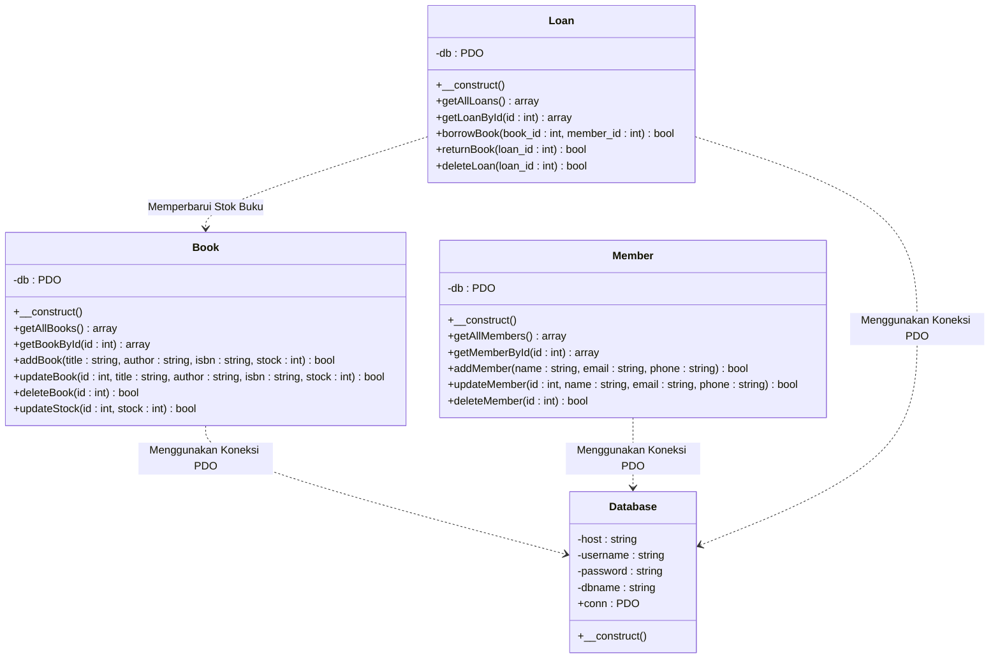
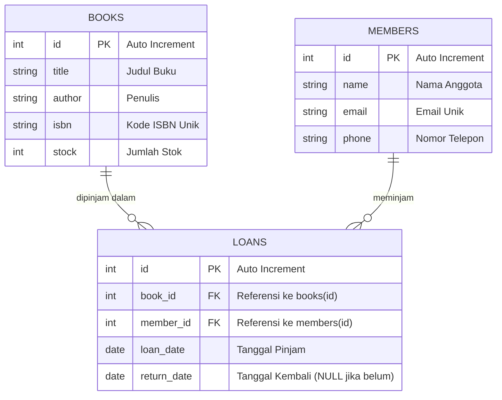
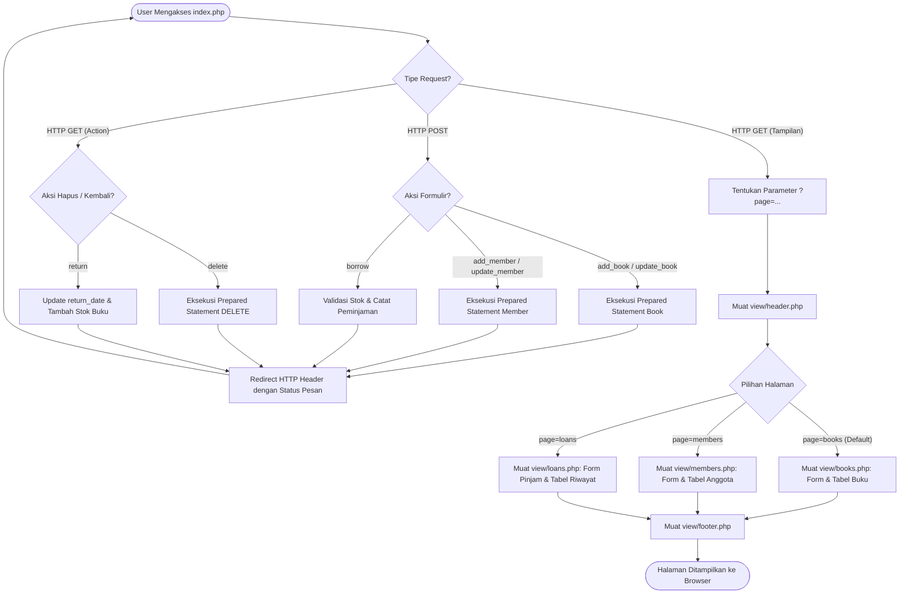

# Tugas Praktikum 7 DPBO 2526 C2 (TP7DPBO2526C2)
Sistem Informasi Manajemen Perpustakaan (**Library System**) berbasis **PHP Native** dengan menerapkan konsep **Object-Oriented Programming (OOP)**, pemisahan antarmuka modular (**GUI**), dan keamanan transaksi database menggunakan **100% Prepared Statements** melalui **PHP Data Objects (PDO)** pada server MySQL.

---

## Janji

> Saya Muhammad Zidan Mirza Fedrieka dengan NIM 2507692 mengerjakan Tugas Praktikum 7 dalam mata kuliah Desain Pemrograman Berorientasi Objek untuk keberkahan-Nya maka saya tidak melakukan kecurangan seperti yang telah dispesifikasikan. Aamiin.

---

## 1. Desain dan Fungsi Program

### A. Deskripsi Umum dan Pemisahan Tanggung Jawab (*Separation of Concerns*)
Website ini mengimplementasikan sistem manajemen peminjaman buku perpustakaan yang dibangun dengan arsitektur berorientasi objek murni (*PHP Native OOP*). Seluruh sistem dipisahkan sesuai tanggung jawabnya (*Separation of Concerns*) secara modular dan terstruktur, mematuhi struktur standar Modul 8:
- **`class/` (Business Logic & Database Interaction):** Berisi Class PHP untuk setiap entitas tabel (`Book.php`, `Member.php`, dan `Loan.php`). Seluruh operasi manipulasi database dikapsulasi di dalam method class dan **wajib menggunakan Prepared Statement** untuk mencegah kerentanan *SQL Injection*.
- **`config/` (Database Connection):** Mengelola koneksi database MySQL terpusat (`db.php`) menggunakan interface **PDO** dengan mode pelaporan galat *Exception* (`PDO::ATTR_ERRMODE => PDO::ERRMODE_EXCEPTION`) dan pengambilan data bertipe array asosiatif (`PDO::ATTR_DEFAULT_FETCH_MODE => PDO::FETCH_ASSOC`).
- **`database/` (Data Definition):** Berisi berkas skrip SQL (`db_library.sql`) yang memuat pembuatan database, skema tabel, relasi *Foreign Key*, serta data awal (*seeding*).
- **`view/` (Modular User Interface):** Berisi komponen antarmuka visual GUI modular (`header.php`, `footer.php`, `books.php`, `members.php`, dan `loans.php`) yang bersih, rapi, dan berfokus pada kemudahan pengguna.
- **`index.php` (Front Controller):** Titik masuk utama aplikasi yang mengatur siklus *HTTP Request-Response*, perutean halaman dinamis (`?page=...`), dan pengalihan aksi (*redirect*) setelah operasi POST/GET untuk mencegah *form resubmission*.
- **`style.css` (Visual Styling):** Penataan antarmuka yang bersih, kontras tinggi, dan responsif.

---

### B. Diagram Class (OOP Architecture)



---

### C. Skema Database dan Relasi Antar Tabel (*Entity Relationship Diagram*)

Database `db_library` terdiri dari **3 entitas** dengan relasi relasional *Foreign Key*:



- **Tabel `books`:** Menyimpan informasi katalog buku dan ketersediaan stok fisik.
- **Tabel `members`:** Menyimpan data identitas anggota perpustakaan yang terdaftar.
- **Tabel `loans`:** Tabel relasional transaksi peminjaman. Memiliki 2 *Foreign Key* (`book_id` ke tabel `books`, dan `member_id` ke tabel `members`) dengan aturan integritas referensial `ON DELETE CASCADE`.

---

## 2. Penjelasan Alur Program

### A. Diagram Alir Permainan / Navigasi Aplikasi



---

### B. Mekanisme Kunci Program

1. **Keamanan Eksekusi Query (100% Prepared Statements):**
   Sesuai spesifikasi Modul 8, seluruh query database baik pembacaan (*SELECT*), penambahan (*INSERT*), pengubahan (*UPDATE*), maupun penghapusan (*DELETE*) dilakukan dengan mekanisme dua tahap:
   ```php
   $stmt = $this->db->prepare("SELECT * FROM books WHERE id = ?");
   $stmt->execute([$id]);
   return $stmt->fetch();
   ```
   Tidak ada satupun pemanggilan query mentah yang rentan penggabungan string (`SQL Injection`).

2. **Integritas Transaksi Peminjaman dan Stok:**
   - **Saat Meminjam Buku (`borrowBook`):** Sistem mengecek ketersediaan stok buku secara atomik melalui prepared statement. Jika stok $> 0$, stok buku otomatis dikurangi $-1$ dan transaksi peminjaman baru dicatat ke tabel `loans` dengan tanggal hari ini (`CURDATE()`). Jika stok habis, sistem menolak peminjaman dan memunculkan notifikasi peringatan.
   - **Saat Mengembalikan Buku (`returnBook`):** Sistem memperbarui kolom `return_date = CURDATE()` pada tabel `loans` dan mengembalikan kuota stok buku terkait $+1$.

3. **Pencegahan Pengiriman Ganda Formulir (*Post/Redirect/Get Pattern*):**
   Setelah pengguna mengirimkan form penambahan atau pengubahan data, server memproses data dan langsung melakukan pengalihan browser menggunakan `header("Location: index.php?page=...&msg=...")`. Hal ini mencegah dialog konfirmasi pengiriman ulang form saat pengguna me-*refresh* halaman.

4. **Desain Antarmuka yang Bersih dan Responsif:**
   Antarmuka sengaja dirancang bersih, fungsional, menggunakan hierarki visual yang jelas, tipografi sistem yang tajam, kontras warna yang nyaman, serta tabel data yang informatif dan mudah digunakan di berbagai ukuran layar.

---

## 3. Dokumentasi Program Saat Dijalankan

### Rekaman Video Pengujian Website
Rekaman video demonstrasi menyeluruh yang memperlihatkan operasi Create, Read, Update, dan Delete untuk ketiga tabel (`books`, `members`, `loans`), validasi stok buku, serta pengembalian buku:

- **Berkas Video:** [`Dokumentasi/dokumentasi_tp7.mp4`](Dokumentasi/dokumentasi_tp7.mp4)

<video src="Dokumentasi/dokumentasi_tp7.mp4" controls width="640">
  <p>Browser Anda tidak mendukung tag video. Silakan tonton berkas rekaman secara langsung melalui tautan berikut: <a href="Dokumentasi/dokumentasi_tp7.mp4">Dokumentasi/dokumentasi_tp7.mp4</a>.</p>
</video>

---

## 4. Panduan Menjalankan Program

### Prasyarat:
* **PHP**: Versi 7.4 atau yang lebih baru (disarankan PHP 8.x).
* **Database**: MySQL / MariaDB (port default `3306`).
* **Web Browser**: Google Chrome, Mozilla Firefox, Microsoft Edge, atau browser modern lainnya.

### Langkah 1: Persiapan Database
1. Pastikan service MySQL berjalan.
2. Impor skrip basis data yang berada di [`database/db_library.sql`](database/db_library.sql) untuk menginisialisasi database `db_library` beserta skema tabel dan data awal:
   ```bash
   mysql -u root -p < database/db_library.sql
   ```
   *(atau gunakan antarmuka manajemen database seperti phpMyAdmin / HeidiSQL)*.

### Langkah 2: Menjalankan Web Server

#### Opsi 1: PHP Built-in Server
1. Buka terminal pada root direktori repositori:
   ```bash
   cd TP7DPBO2526C2
   ```
2. Jalankan server lokal bawaan PHP:
   ```bash
   php -S localhost:8000
   ```
3. Buka browser dan akses:
   ```
   http://localhost:8000
   ```

#### Opsi 2: Web Server Lokal (Apache / Laragon / XAMPP)
Tempatkan direktori proyek pada root web server (`www` atau `htdocs`), lalu akses melalui host lokal yang dikonfigurasi.

